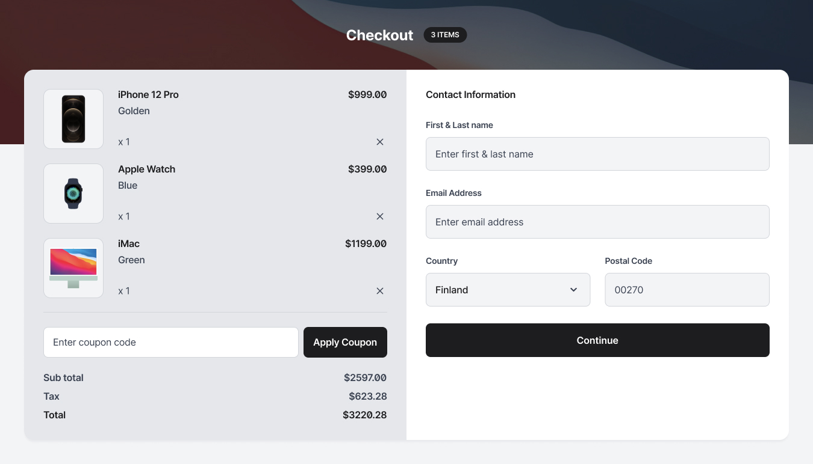
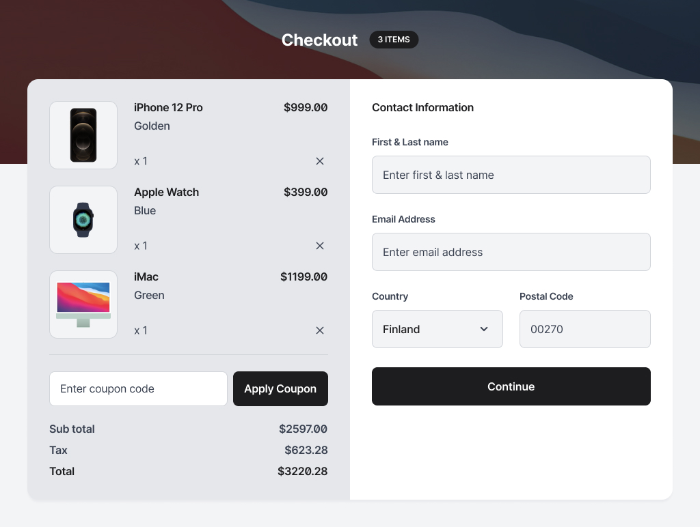
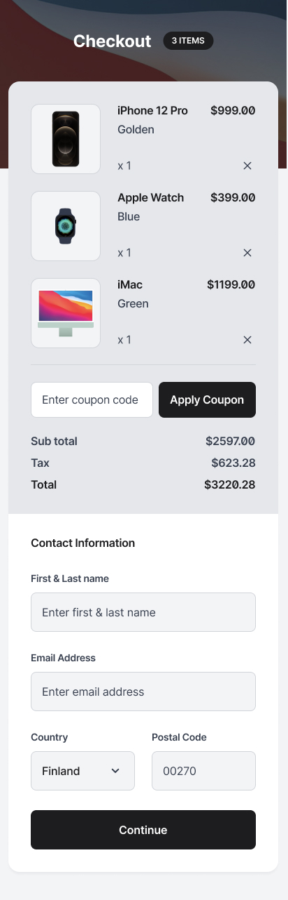

# Device Shop Checkout

A responsive device shop checkout page built with HTML, CSS, and JavaScript. This project was created as part of a front-end development challenge to practice responsive layouts, form design, CSS Grid, and Flexbox.

## Links

- **Live Demo:** [View Website](https://christianogalileo.github.io/device-shop-checkout/)
- **Solution:** [GitHub Repository](https://github.com/christianogalileo/device-shop-checkout)
- **Challenge:** [devChallenges](https://devchallenges.io/)

## Table of Contents

- [Overview](#overview)
- [Screenshot](#screenshot)
- [What I Learned](#what-i-learned)
- [Built With](#built-with)
- [Features](#features)
- [Useful Resources](#useful-resources)
- [Acknowledgements](#acknowledgements)
- [Author](#author)

## Overview

The Device Shop Checkout project is a responsive checkout interface designed to provide users with a simple and clear shopping experience. It displays a product summary, pricing information, a coupon field, and a contact information form.

The layout is designed to work across desktop, tablet, and mobile screen sizes.

### Screenshot

**Desktop Preview**

**Tablet Preview**

**Mobile Preview**

## What I Learned

While building this project, I practiced:

- Creating responsive layouts using CSS Grid and Flexbox.
- Designing and styling HTML forms.
- Using CSS media queries for desktop, tablet, and mobile screens.
- Displaying product images using responsive image techniques.
- Implementing basic form validation with JavaScript.
- Creating a coupon interaction that updates the subtotal, tax, and total.
- Organizing project assets into folders.
- Deploying a static website using GitHub Pages.

## Built With

- HTML5
- CSS3
- JavaScript
- CSS Grid
- Flexbox
- Responsive Web Design
- Git and GitHub
- GitHub Pages

## Features

- Responsive checkout layout.
- Product summary featuring:
  - iPhone 12 Pro — Gold
  - Apple Watch — Blue
  - iMac — Green
- Product images with high-resolution image support.
- Coupon code input with a demo discount code: `SAVE10`.
- Automatic subtotal, tax, and total calculation.
- Contact information form with required fields.
- Basic client-side form validation.
- Background image and product assets.
- Responsive navigation and checkout interface.

### Example Order Summary

| Item | Price |
|---|---:|
| iPhone 12 Pro | $999.00 |
| Apple Watch | $399.00 |
| iMac | $1,199.00 |
| **Subtotal** | **$2,597.00** |
| Tax (24%) | $623.28 |
| **Total** | **$3,220.28** |

*Note: This is a front-end demonstration. The coupon, calculations, and form validation run in the browser. No real payment or order processing is implemented.*

## Useful Resources

- [MDN Web Docs](https://developer.mozilla.org/) — Documentation for HTML, CSS, and JavaScript.
- [CSS Grid Guide](https://developer.mozilla.org/en-US/docs/Web/CSS/CSS_grid_layout) — A guide to building grid-based layouts.
- [Flexbox Guide](https://developer.mozilla.org/en-US/docs/Web/CSS/CSS_flexible_box_layout) — A guide to flexible layouts.
- [GitHub Pages Documentation](https://docs.github.com/en/pages) — Instructions for deploying static websites.
- [devChallenges](https://devchallenges.io/) — Front-end development challenges and learning resources.

## Acknowledgements

Thanks to devChallenges for providing the challenge and design references that inspired this project.

Thanks to the developers and documentation contributors who provide helpful resources for learning modern web development.

## Author

- **Name:** christianogalileo
- **GitHub:** [@christianogalileo](https://github.com/christianogalileo)
- **Project Repository:** [device-shop-checkout](https://github.com/christianogalileo/device-shop-checkout)
